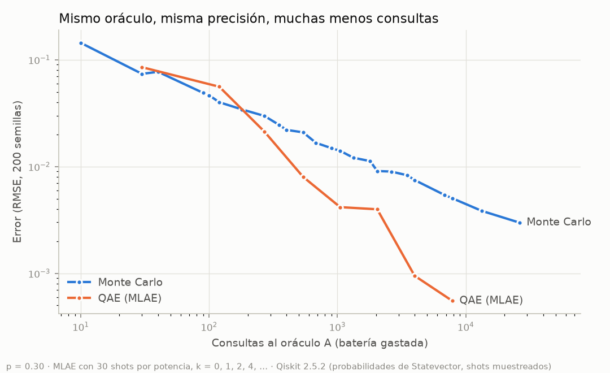

# Prueba del QAE (2.2 «Doble Hueso») — resultados

Script: `qae_spike.py` (Qiskit 2.5.2, semilla 2026). Salida completa en
`salida.txt` y datos en `resultados.json`.

```bash
PYTHONIOENCODING=utf-8 uv run --no-project --with "qiskit==2.5.2" --with matplotlib python experiments/qae/qae_spike.py
```

`matplotlib` solo se usa para dibujar la gráfica del experimento; no es
dependencia del producto.

## Q1. Circuitos con compuertas explícitas

- **Oráculo A:** `RY(2·arcsin √p)` sobre 1 qubit, así que P(medir 1) = p = sin²θ.
- **Grover Q = A·S₀·A†·S_χ**, en orden de circuito: `Z` (S_χ, cambia el signo
  de |1⟩) → `A†` → `X·Z·X` (S₀ = I − 2|0⟩⟨0|) → `A`.
- Comprobado: P(1) de Qᵏ·A = sin²((2k+1)θ), con diferencia máxima 2.7·10⁻¹⁵
  para cuatro valores de p y k = 0…16.

Circuito para k = 1 y p = 0.30:

```
    ┌────────────┐┌───┐┌─────────────┐┌───┐┌───┐┌───┐┌────────────┐ ░ ┌─┐
 q: ┤ Ry(1.1593) ├┤ Z ├┤ Ry(-1.1593) ├┤ X ├┤ Z ├┤ X ├┤ Ry(1.1593) ├─░─┤M├
    └────────────┘└───┘└─────────────┘└───┘└───┘└───┘└────────────┘ ░ └╥┘
```

Monte Carlo usa el mismo A con k = 0: cada olfateo es una consulta.

Para las 200 semillas, los shots se sortean binomialmente sobre las
probabilidades exactas de `Statevector`. Es lo mismo que hace
`StatevectorSampler`: con 40 000 shots su frecuencia queda a 0.6 σ de la
exacta. Las trayectorias y los tiempos usan `StatevectorSampler`, como el
backend.

## Q2. MLAE

Para cada potencia k se miden `shots` veces Qᵏ·A y se cuentan los «1». θ se
estima maximizando la log-verosimilitud
Σₖ hₖ·log sin²((2k+1)θ) + (Nₖ − hₖ)·log cos²((2k+1)θ) en una grilla de 20 000
puntos en (0, π/2); la estimación es p = sin²θ. Con una grilla 20 veces más
fina el error no cambia, así que la grilla no limita.

## Q3. Error contra consultas (p = 0.30, 200 semillas)

Consultas = Σ shots·(2k+1). Pendientes log-log con potencias
k = 0, 1, 2, 4, … (al menos tres potencias):

| Método | Pendiente del RMSE | Pendiente del error mediano |
| --- | --- | --- |
| Monte Carlo | **−0.50** | −0.51 |
| MLAE, 30 shots por potencia | **−1.05** | −0.97 |
| MLAE, 100 shots por potencia | −1.04 | −1.03 |
| MLAE, 10 shots por potencia | inestable (−0.29 y −1.15 en dos corridas) | −1.03 |

Con 10 shots por potencia, el error *típico* (mediana) sí baja como 1/N, pero
de vez en cuando la verosimilitud elige un alias de θ. Esos errores raros y
grandes dominan el RMSE. Con 30 shots o más desaparecen.



MLAE con 30 shots por potencia:

| Potencias | Consultas | RMSE | Mediana |
| --- | --- | --- | --- |
| 0, 1, 2 | 270 | 0.0212 | 0.0106 |
| 0, 1, 2, 4 | 540 | 0.0080 | 0.0045 |
| 0, 1, 2, 4, 8 | 1 050 | 0.0042 | 0.0027 |
| 0 … 16 | 2 040 | 0.0040 | 0.0015 |
| 0 … 32 | 3 990 | 0.0009 | 0.0006 |
| 0 … 64 | 7 860 | 0.0006 | 0.0004 |

Monte Carlo necesita unas 25 000 consultas para un RMSE de 0.003.

## Q4. ¿Hace falta k = 0?

**Sí, se mantiene.** Con una sola potencia k = 1, la verosimilitud es
exactamente simétrica entre θ y su alias: sin²(3θ) da lo mismo para p = 0.30
y para p = 0.204. Solo el k = 0 rompe el empate. En esquemas largos las
demás potencias también lo rompen, y la diferencia se achica (30 shots hasta
k = 8: RMSE 0.0042 con k = 0 y 0.0052 sin él). Pero la batería del juego da
para un esquema corto, y ahí sí importa. Además, k = 0 es justo un olfateo de
Monte Carlo: Q-Boby empieza oliendo como el chip simple y luego amplifica.

## Q5. Presupuesto de batería (túneles con p = 0.30 y 0.36)

Elegir el túnel bueno, en 1000 semillas por fila (dos corridas
independientes):

| Esquema | Consultas por túnel | QAE elige bien | MC elige bien (mismas consultas) |
| --- | --- | --- | --- |
| 3 shots, k = 0, 1, 2, 4 | 54 | 88 % | 71–73 % |
| **5 shots, k = 0, 1, 2, 4** | **90** | **95.3–95.6 %** | **75.6–79.3 %** |
| 10 shots, k = 0, 1, 2, 4 | 180 | 99.3–99.9 % | 86.6–89.6 % |

Monte Carlo necesita ~400 consultas por túnel para elegir bien el 96.5 % de
las veces: unas **4.4 veces más** que QAE.

**Batería del minijuego: 180 consultas (90 por túnel), con 5 shots por
potencia y k = 0, 1, 2, 4.** Con esa batería QAE pasa el 95 % y Monte Carlo
se queda cerca del 77 %.

Más shots por potencia con menos potencias no es mejor: los esquemas de 2–3
shots con k hasta 16–32 se quedan bajo el 92 %, por los alias.

## Q6. Tiempo

Mediana de 20 corridas completas con `StatevectorSampler`:

| Estimación | Tiempo |
| --- | --- |
| QAE, k = 0, 1, 2, 4, 8, 3 shots | 14 ms |
| QAE, k = 0 … 16, 3 shots | 22 ms |
| Monte Carlo, 300 consultas | 2.4 ms |

Muy por debajo de los 300 ms pedidos.

## Trayectoria (D15)

Ejemplo real (semilla 7, p = 0.30, 3 shots por potencia). Es lo que devuelve
`estimates` y anima el frontend:

| Consultas | Estimación QAE | Error |
| --- | --- | --- |
| 3 | 0.667 | 0.367 |
| 12 | 0.322 | 0.022 |
| 27 | 0.338 | 0.038 |
| 54 | 0.277 | 0.023 |
| 105 | 0.251 | 0.049 |

Una sola corrida es ruidosa: el primer punto es un Monte Carlo de 3 olfateos.
La ventaja se ve en promedio, como en la gráfica de arriba. Recomendación:
la gráfica en vivo muestra la trayectoria de la ronda, y el cromo o el
Rayos-X muestran la gráfica promediada de este experimento (datos reales,
reproducibles con la semilla).

## Q7. Ruido

Descartado (D16): no se añade `qiskit-aer`.

## Q8. Fuentes verificadas (abstracts en arXiv, 2026-10-24)

- Brassard, Høyer, Mosca y Tapp (2002). *Quantum Amplitude Amplification and
  Estimation*. En *Quantum Computation and Quantum Information*, AMS
  Contemporary Mathematics 305, 53–74. arXiv:quant-ph/0005055. Combinan ideas
  de Grover y Shor para estimar amplitudes con aceleración cuadrática.
- Suzuki, Uno, Raymond, Tanaka, Onodera y Yamamoto (2020). *Amplitude
  estimation without phase estimation*. Quantum Information Processing 19, 75.
  arXiv:1904.10246. Máxima verosimilitud sobre mediciones de circuitos con
  distinto número de amplificaciones; sin estimación de fase; «casi la
  aceleración cuántica óptima» en simulación.
- Tanaka, Suzuki, Uno, Raymond, Onodera y Yamamoto (2021). *Amplitude
  estimation via maximum likelihood on noisy quantum computer*. Quantum
  Information Processing 20, 293. arXiv:2006.16223. En un equipo de IBM, el
  error de estimación **se satura por el ruido**, aunque el método mantiene
  la aceleración en número de consultas.

## Frases honestas para Chispa

- «Con el mismo olfato, el chip cuántico necesitó unas 4 veces menos
  olfateos. La ventaja es en consultas, no en tiempo: aquí todo corre en una
  laptop.»
- «En los chips ruidosos de hoy, el error deja de bajar pasado cierto punto:
  el ruido le pone un piso a la ventaja (Tanaka et al., 2021).»

Corrección: «el ruido se come esa ventaja» exagera. La fuente dice que el
error se satura, no que la ventaja desaparezca.

## Veredicto

El QAE hecho a mano funciona con 1 qubit, escala como 1/N contra 1/√N de
Monte Carlo sobre el mismo oráculo, tarda decenas de milisegundos, y la
batería de 180 consultas separa a los dos chips de forma clara y honesta.
